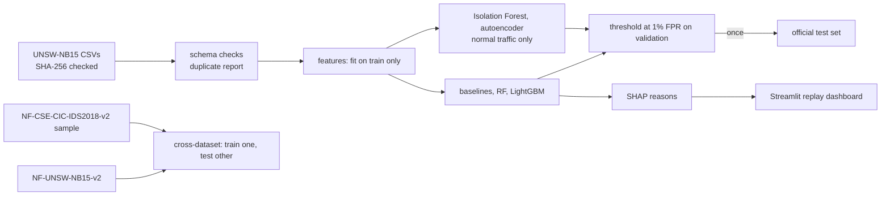

# Architecture

## Context

An offline ML project on one laptop. It answers three questions about network flow records:

1. **Is a flow an attack?** Binary detection, measured at a fixed false-alarm budget. An analyst queue drowns long before recall becomes the problem.
2. **Which kind of attack?** Multi-class, with recall per class. The rare classes are the interesting ones.
3. **Does it still work on a different network?** A model trained on one testbed, scored on another with the same features. This is the "drift between datasets" in the plan, and the result most NIDS papers leave out.

The output is a reproducible pipeline, notebooks, reports, SHAP explanations per alert, and a small dashboard that replays test flows as live alerts.

## Dataset

| Option | Terms | Size | Notes |
|---|---|---|---|
| **UNSW-NB15, official train/test CSVs (chosen)** | Free for academic research; commercial use must be agreed with the authors (UNSW ReadMe). Cite Moustafa and Slay 2015 and 2016 | 175,341 train / 82,332 test flows, 49 features, 9 attack categories | The plan's choice. Modern attack categories compared with KDD'99/NSL-KDD |
| CIC-IDS2017 | Free to use with citation (CIC) | ~2.8M flows, 8 CSVs (~1 GB) | Well known, but its labels and flow extraction have documented bugs (Engelen et al. 2021) |
| NF-UNSW-NB15-v2 + NF-CSE-CIC-IDS2018-v2 (UQ NetFlow versions) | No licence text found for the NetFlow versions; the source datasets' terms apply | 2.4M and 18.9M flows, the same 43 NetFlow features | The only clean way to test across datasets, because both share one feature set |

Chosen: **UNSW-NB15 for days 2 to 7, plus the two NetFlow versions for one cross-dataset test** (NF-CSE-CIC-IDS2018-v2 sampled to about 1M flows).

The terms mean:
- data is never committed or re-hosted, and a script downloads it;
- trained models aren't published, only code and results;
- the README states the terms.

Download: the official UNSW files sit on a SharePoint link that can't be pinned or fetched by a script. They're fetched once by hand, and the script checks them against SHA-256 hashes recorded in the repo. A Hugging Face mirror (`Mireu-Lab/UNSW-NB15`) could be pinned by commit, but it relabels the data GPL-3.0, which isn't its licence, so it's used only if its hashes match the official files.

## Known problems with the data (to measure, not hide)

- **TTL features nearly give the label away.** In UNSW-NB15, `sttl`, `dttl` and `ct_state_ttl` reflect how the testbed generated traffic, not how attacks behave. A model can score highly on them alone. They get a single-feature baseline, and every model is reported with and without them.
- **The official split isn't random, and its class mix differs** between train and test. It is kept as-is (it's what papers report against), with validation carved from train.
- **Duplicate flows** within and across splits. They're counted, and test-set rows that repeat train are reported separately.
- **`id` and `attack_cat`/`label` columns** must never reach the features. A test enforces this.

## Setup

| Item | Choice | Why |
|---|---|---|
| Split | Official train/test; validation is 20% of train, stratified by category | Comparable with published work; the test set is scored once |
| Binary metric | Recall at 1% false-positive rate, PR-AUC, alerts per 10k benign flows | Accuracy is meaningless when the classes are this unbalanced |
| Multi-class metric | Recall per category, macro-F1, confusion matrix | The common classes hide the rare ones |
| Baselines | Majority class, a TTL-only rule, logistic regression | Anything has to beat a one-feature rule to count |
| Models | Random forest, LightGBM; Isolation Forest and a small autoencoder trained only on normal traffic | Supervised vs "learn normal, flag the rest" |
| Explainability | SHAP (TreeExplainer) for LightGBM: global importance and per-alert reasons | Checks whether the model leans on testbed artifacts |
| Cross-dataset | Train on NF-UNSW-NB15-v2, test on NF-CSE-CIC-IDS2018-v2 (and the reverse), binary only | Attack categories don't line up across datasets; attack vs benign does |

## Components

| Component | Where | What it does |
|---|---|---|
| Data | `src/nids/data.py` | Hash-checked load, schema checks (types, ranges, categories), duplicate report |
| Features | `src/nids/features.py` | One preprocessing pipeline (log scale, categorical encoding with an "unseen" bucket), fit on train only |
| Models | `src/nids/models.py` | Baselines, supervised and anomaly models; LightGBM saved in its text format, not pickled |
| Evaluate | `src/nids/evaluate.py` | Thresholds at a fixed FPR on validation, per-class recall, bootstrap intervals, cross-dataset |
| Explain | `src/nids/explain.py` | SHAP summaries and per-alert top reasons |
| Dashboard | `app/` (Streamlit) | Replays test flows at a set speed, shows alerts with reasons; read-only, local only |
| Notebooks | `notebooks/` | EDA, models, anomaly vs supervised, SHAP, cross-dataset |

## Data flow

## Threat model (STRIDE, short)

| | Threat | Mitigation |
|---|---|---|
| Spoofing | A look-alike or edited dataset file | SHA-256 of each file recorded in the repo and checked before use |
| Tampering | A saved model swapped | LightGBM text format; anything else loaded from hash-checked bytes |
| Tampering (evasion) | An attacker shapes traffic to look benign (e.g. sets TTL to normal values) | The with/without-TTL results show how much detection depends on easy-to-fake features; the README says so |
| Information disclosure | Flow records hold IP addresses (testbed ranges, but still addresses) | IPs and ports aren't model features; the dashboard shows them only from the local test file |
| Denial of service | The dashboard handed a huge or malformed file | It only replays the processed test set, with size caps and schema checks |
| Elevation (misuse) | The model used as a real NIDS on a production network | The README says it's a research model trained on one testbed, with cross-dataset results that show why |

## Decisions (agreed 16 Nov 2026)

1. Dataset: UNSW-NB15 (academic terms, no data or model redistribution) plus the NetFlow pair for the cross-dataset test.
2. Download by hand once and check by hash in the script (the official link can't be scripted).
3. Streamlit for the dashboard (fast, Python-only) rather than Next.js. ThreatLens already shows the Next.js side.
4. TTL features: report with and without them, rather than silently dropping them.

## Limitations known before starting

- Lab testbeds, not real enterprise traffic, and the attacks are generated by tools.
- Flow features only; no payloads, so no content-based detection.
- Offline evaluation; the dashboard replays recorded flows, it doesn't capture live traffic.
